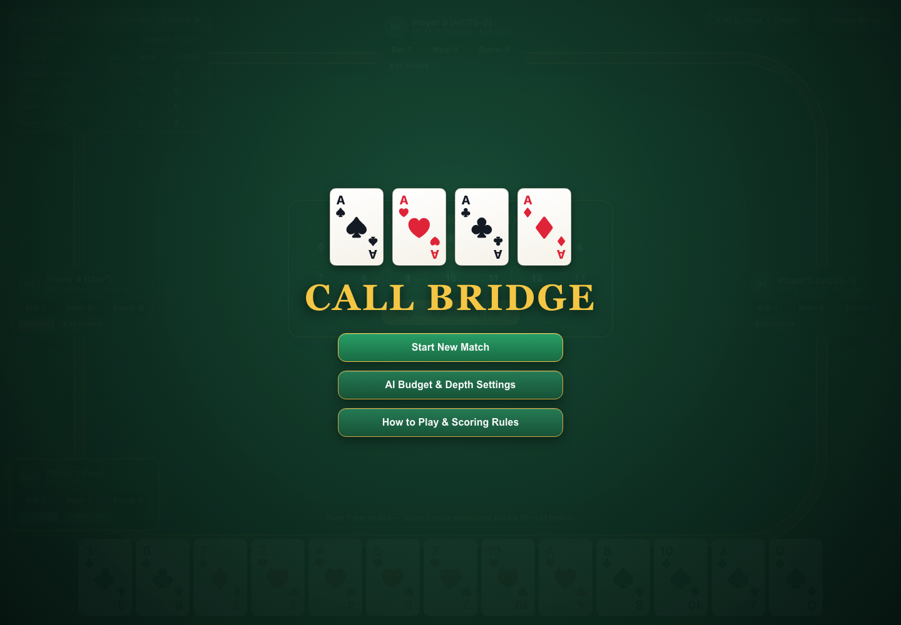
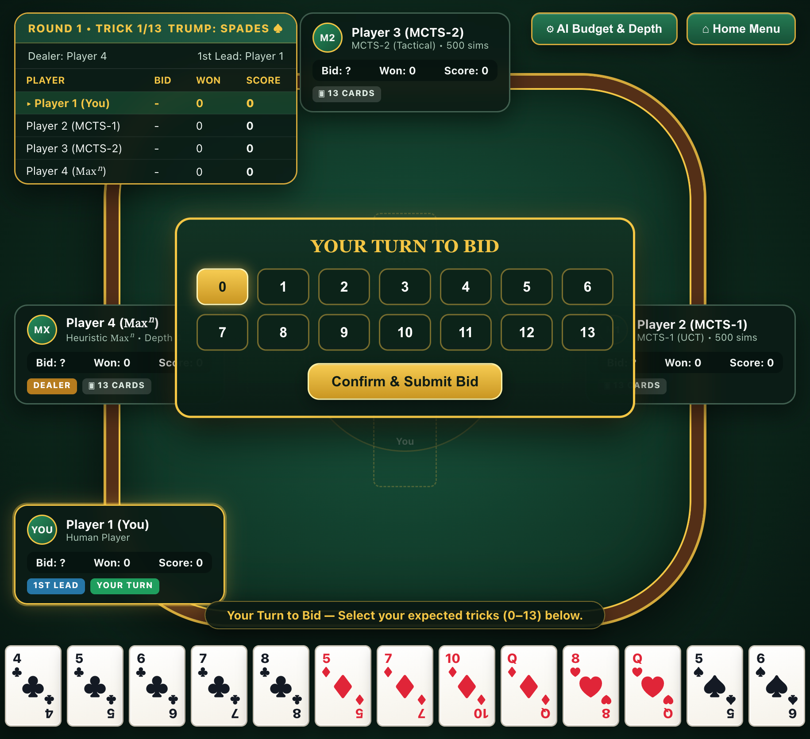
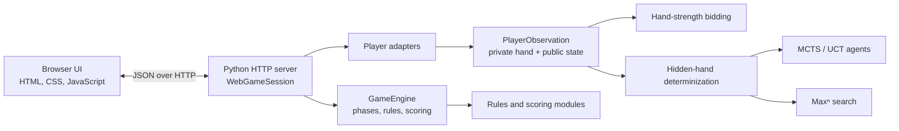
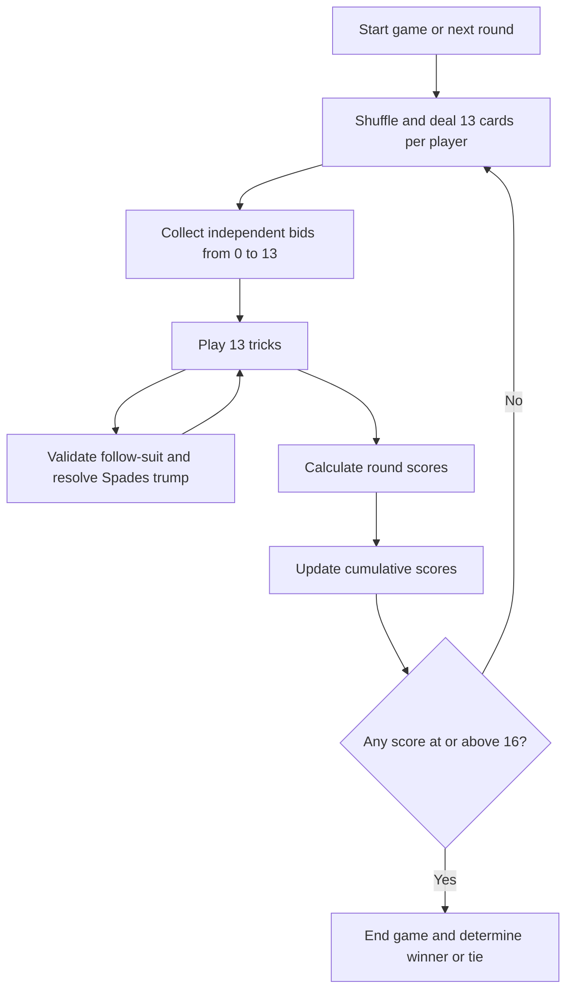

# Call Bridge

Call Bridge is a four-player trick-taking game with a browser UI and three AI opponents. The project is built around a Python game engine, a small JSON-over-HTTP interface, and imperfect-information search agents.

## Features

- Centralized game engine for phases, turn order, legal moves, trick resolution, and scoring.
- Browser interface for bidding, card play, score tracking, rules, and AI configuration.
- Two Monte Carlo Tree Search (MCTS) agents with independent simulation budgets and rollout strategies.
- A heuristic multiplayer Maxⁿ agent with configurable search depth.
- Player-specific observations and hidden-hand determinization constrained by public play history and known void suits.
- Unit tests for the rules, engine, scoring, search agents, and hidden-information behavior.

## User interface

The landing screen provides access to a new match, AI settings, and game rules. In a match, the table displays all player seats, public bids and scores, the current trick, trump suit, and the human player's hand.



The gameplay view shows the live scoreboard, player seats, bid controls, and hand:



## Architecture



### Components

| Directory or file | Responsibility |
| --- | --- |
| `game/` | Card and deck models, game state, rules, trick resolution, scoring, and authoritative engine. |
| `players/` | Human, MCTS, Maxⁿ, and random player adapters using a shared interface. |
| `ai/` | Bidding, determinization, MCTS, rollout policies, Maxⁿ recursion, and heuristic evaluation. |
| `ui/` | Browser assets, configuration, and the HTTP session/server connecting UI actions to the engine. |
| `tests/` | Unit tests for game behavior and AI information boundaries. |
| `main.py` | Application entry point and command-line options. |

### Technology

- **Python 3.10+** for the game engine, AI, HTTP server, and CLI.
- **HTML, CSS, and JavaScript** for the browser UI; no frontend framework or build step.
- **Python standard library** for runtime functionality. No third-party runtime packages are required.
- **pytest** for the automated test suite (`requirements.txt`).

## Game flow and rules



- Four players compete individually, each receiving 13 cards. Spades are always trump.
- The leader may play any card. Other players must follow the lead suit if possible; a player who is void may play any card.
- The highest Spade wins a trick if any Spade was played. Otherwise, the highest card of the lead suit wins and leads the next trick.
- Each player's bid is independent; bids do not need to total 13.
- Scores are computed after all 13 tricks. For bid `b` and tricks won `t`:

  | Outcome | Points |
  | --- | ---: |
  | `t < b` | `-b` |
  | `t == b` | `+b` |
  | `t == b + 1` | `0` |
  | `t > b + 1` | `-(t - b - 1)` |

Round scores accumulate. The game ends after a completed round when at least one player reaches 16 points. The highest cumulative score wins; tied highest scores result in a tie.

## AI and information boundaries

AI agents make decisions using `PlayerObservation`, which contains the agent's hand and public game information, including played cards, trick history, remaining hand sizes, and known void suits. It does not expose opponents' actual hands. The determinization module samples possible hidden deals consistent with this information and uses those deals for search.

- **Bidding:** estimates likely tricks from hand strength, including honors, trump count, and suit distribution, then adjusts for the scoring rule and current score.
- **MCTS-1:** UCT search with exploration constant `1.414` and strategic rollouts.
- **MCTS-2:** UCT search with exploration constant `0.90` and a more trump-conserving rollout policy.
- **Maxⁿ:** searches a configurable number of plies over multiple determinizations. Each player selects the continuation maximizing their own component of a four-player utility vector. The search limits branching by considering representative moves when there are many legal cards.

The session runs AI decisions on a single-worker executor, keeping search work off the HTTP request path. Chosen moves are submitted to the engine, which remains responsible for legality and state transitions.

## Run locally

Requirements: Python 3.10 or later. Runtime dependencies use only the Python standard library.

```bash
git clone <repository-url>
cd "Call Bridge"
python3 -m venv .venv
source .venv/bin/activate        # Windows: .venv\Scripts\activate
python -m pip install -r requirements.txt
python main.py
```

The server opens the game at [http://127.0.0.1:8765](http://127.0.0.1:8765). Stop it with `Ctrl+C` in the terminal.

### AI settings

Defaults are 500 simulations for each MCTS agent and depth 4 for Maxⁿ. Settings are available in the UI and through command-line flags. The server clamps MCTS budgets to 10–50,000 simulations and Maxⁿ depth to 1–12.

```bash
python main.py --mcts1-budget 1000 --mcts2-budget 500 --maxn-depth 4
python main.py --port 9000 --no-browser
```

### Tests and evaluation

```bash
python -m pytest -v
python main.py --evaluate --eval-games 2
```

Evaluation mode runs a seeded comparison of the random, MCTS, and Maxⁿ agents and prints summary tables.

## HTTP interface

The browser polls `GET /api/state` for public game state. Human actions and settings use JSON `POST` requests.

| Endpoint | Action |
| --- | --- |
| `/api/new_game` | Start a new match and reset scores. |
| `/api/bid` | Submit the human player's bid. |
| `/api/play` | Submit a card to play. |
| `/api/next_round` | Deal the next round after a round completes. |
| `/api/settings` | Update the MCTS budgets and Maxⁿ depth. |
